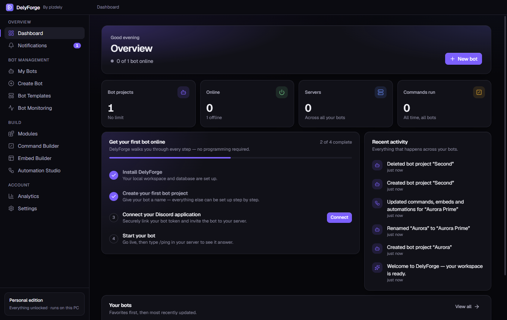
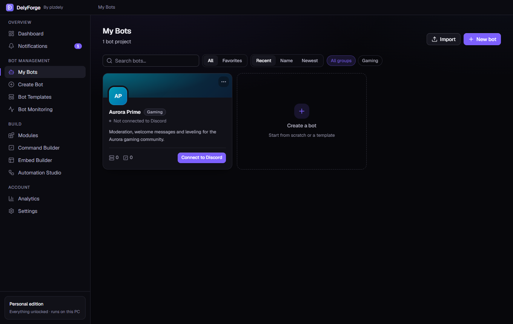
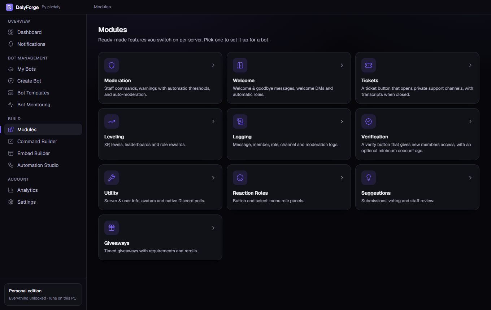
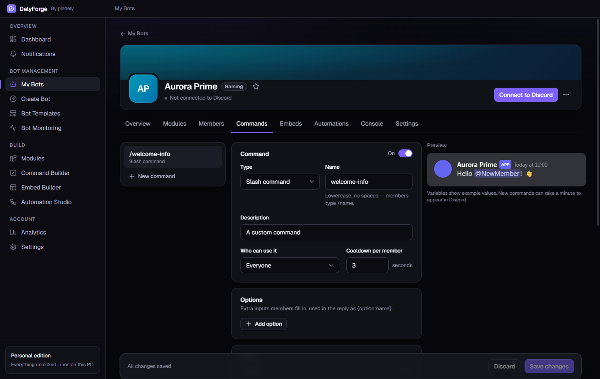
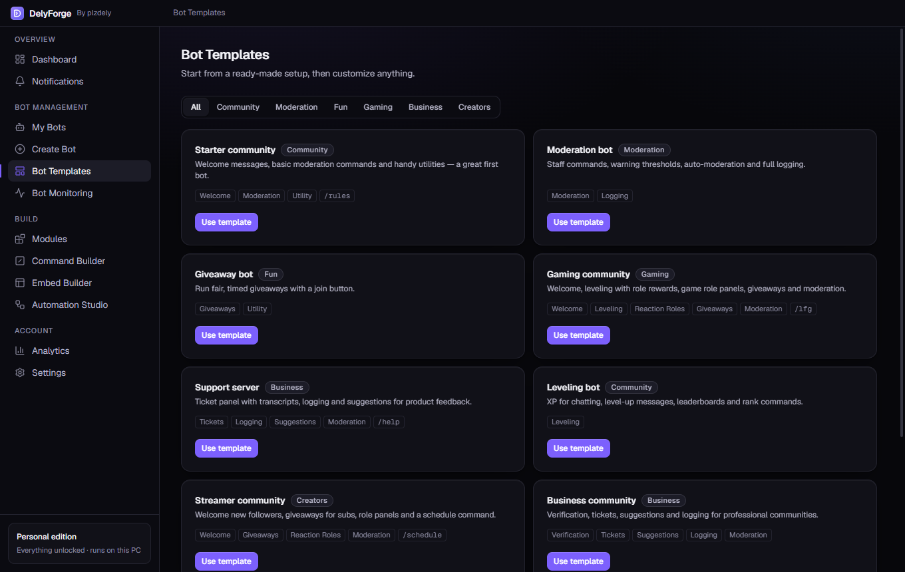

<div align="center">


# DelyForge

**Build. Automate. Control.**

Make your own Discord bot in a few minutes — no coding. Pick features, click Start, done.

Windows desktop app · Your bot runs on your own PC · Free

</div>



## What is it?

DelyForge is a Windows app for making and running Discord bots. You don't write any code: you turn on ready-made
features (welcome messages, moderation, tickets, levels…), build your own commands with a visual editor, and press
**Start**. The bot runs right on your computer, and keeps running in the system tray when you close the window.

Your bot's token (its password) is encrypted and never leaves your PC.

## Features

| | |
|---|---|
| 🤖 **Many bots, one app** | Create, group, favorite, start and stop as many bots as you like. |
| 🧩 **31 ready-made modules** | Moderation (cases, temp bans, lockdown, AutoMod), Welcome, Tickets, Leveling, Logging (who did what), Verification, Utility, Reaction Roles, Suggestions, Giveaways, Invite Tracker, Starboard, Temporary Voice, Raid Protection (with anti-nuke), Sticky Messages, Server Stats, Birthdays, Social Alerts (YouTube + RSS), Scheduled Messages, Shop, Modmail, Applications, Economy, Counting & Games, Auto-responder, Confessions, Highlights, Channel Automation, Activity Stats, Reputation, Member Tools. |
| 🩺 **Setup Doctor** | Checks a server for every module that's on and explains each problem in plain English, with the fix. |
| 🧪 **Test buttons** | Send a test welcome, level-up, birthday or feed post with one click, and preview every message Discord-style. |
| ⌨️ **Command Builder** | Make your own slash commands visually, with a live preview of how the reply looks in Discord. |
| 🎨 **Embed Builder** | Design rich Discord message cards and reuse them in commands and automations. |
| ⚡ **Automation Studio** | "When this happens in Discord, do that" — on joins, messages, reactions, boosts, voice or a schedule, with variables and If/Otherwise. |
| 📦 **10 templates** | Start from a gaming, support, streamer, business, roleplay or all-in-one bot. |
| 👥 **Members tab** | See and remove warnings, check the level leaderboard, reset XP — even while the bot is offline. |
| 📈 **Monitoring & analytics** | Live status, latency, CPU and memory, plus uptime and command usage over time. |
| 🔔 **Alerts** | A notification when a bot disconnects, crashes, can't log in or loses a permission — and the bot can DM you about it. |
| 💾 **Backups** | Save a bot's whole setup to a file and restore it later. |
| 🌙 **Runs in the background** | Close the window and your bots keep going in the tray. Optionally start with Windows. |

## Screenshots

| Your bots | Pick features |
|---|---|
|  |  |
| **Build commands with a live preview** | **Start from a template** |
|  |  |

## Get DelyForge

1. Go to the **[latest release](https://github.com/plzdely/DelyForge/releases/latest)**.
2. Under **Assets**, click **DelyForge-Setup-0.1.0.exe** to download it.
3. Double-click the file. DelyForge installs in a few seconds — no admin password, no wizard — and opens. You'll find
   it on your desktop and in the Start menu.

> **"Windows protected your PC"?** The installer isn't code-signed (a signing certificate costs money), so Windows
> doesn't recognise it yet. Click **More info → Run anyway**.

<details>
<summary><b>Or build it yourself from the code</b></summary>

1. Install [Node.js](https://nodejs.org) (the **LTS** version, 22.12 or newer) and [Git](https://git-scm.com/download/win).
2. Open **PowerShell** and run these one at a time:
   ```bash
   npm install -g pnpm
   ```
   ```bash
   git clone https://github.com/plzdely/DelyForge.git
   ```
   ```bash
   cd DelyForge
   ```
   ```bash
   pnpm install
   ```
   ```bash
   pnpm --filter @delyforge/desktop dist:unsigned
   ```
3. Open the `apps\desktop\release` folder and double-click **DelyForge-Setup-0.1.0.exe**.

</details>

## Your first bot in 5 minutes

DelyForge walks you through all of this inside the app (**Create Bot** → **Connect to Discord**). Here is the short
version so you know what to expect:

1. **Create the bot in DelyForge.** Click **Create Bot**, give it a name, click **Create**.
2. **Make a Discord application.** Click **Open Developer Portal** in the app, sign in with Discord, click
   **New Application**, name it, and click **Create**. (Optional: upload an icon — that becomes your bot's picture.)
3. **Copy the token.** In the portal, open **Bot** in the left menu → **Reset Token** → **Copy**. Paste it into
   DelyForge and click **Verify & save**. The app tells you if you pasted the wrong thing (like the Client Secret).
4. **Invite the bot to your server.** Pick what the bot is allowed to do, then open the invite link the app gives you
   and choose a server where you have *Manage Server*.
5. **Start it.** Click **Start**. Within a few seconds your bot shows as online in Discord. Type `/ping` to check.
6. **Add features.** Open your bot's **Modules** tab and turn on what you want — welcome messages, moderation, tickets,
   levels, logging (who did what), invite tracking, starboard, temporary voice channels, raid protection, birthdays
   and more.

> Some modules need extra Discord permissions called *privileged intents* (for example reading message text for
> auto-moderation). If one is missing, DelyForge tells you exactly which switch to turn on under **Bot** in the
> Developer Portal.

## Privacy and safety

- **Your token stays on your PC.** It's encrypted with Windows' secure storage, never shown again after you save it,
  and never written to logs.
- **No account needed.** Everything is stored locally in `%APPDATA%\DelyForge`. Uninstalling keeps your bots, so a
  reinstall picks up where you left off.
- **Bots only run built-in features.** Commands, automations, templates and backups are settings, not code, so a
  shared template or backup file can't run anything on your computer.

See [SECURITY.md](SECURITY.md) for the details.

## FAQ

**Does my PC have to stay on?** Yes — the bot runs on your computer, so it's online while DelyForge is running (in the
window or the tray). Turn on **Start with Windows** in Settings so it comes back after a restart.

**Does it cost anything?** No. Discord bots are free to make, and DelyForge runs everything on your own PC.

**Mac or Linux?** Not yet — DelyForge is Windows only for now.

**My bot is offline.** Open the bot in DelyForge and check the **Console** tab; it says what went wrong in plain words
(wrong token, missing intent, no internet…). Make sure the bot is started and DelyForge is still running in the tray.

---

## For developers

DelyForge is a TypeScript monorepo (pnpm workspaces).

| Path | What it is |
|---|---|
| `apps/desktop` | The Electron 45 + React 19 + Tailwind app (main process, preload, renderer) |
| `packages/bot-runtime` | The per-bot process (discord.js); runs only built-in, config-driven behaviour |
| `packages/shared` | Shared code: module settings, IPC contract, plans, secret redaction |
| `apps/api` | Optional cloud API (NestJS + Prisma + PostgreSQL) for accounts, AI, marketplace and teams |

**Personal edition:** `PERSONAL_EDITION = true` in `packages/shared/src/brand.ts` unlocks everything with no sign-in and
hides the screens that need a paid server (Account, Subscription, AI, Marketplace, Team). The commercial code is still
built and tested; set the switch to `false` to bring it back.

### Commands

Run these from the repo root.

```bash
pnpm install
```

```bash
pnpm dev:desktop
```

```bash
pnpm test
```

```bash
pnpm typecheck
```

```bash
pnpm test:smoke
```

- `dev:desktop` runs the app with hot reload.
- `test:smoke` builds and launches the real app, checks every screen renders and saves screenshots to
  `apps/desktop/out/smoke/`.
- Cloud API (optional): copy `apps/api/.env.example` to `apps/api/.env`, then `pnpm db:up`, `pnpm db:migrate`,
  `pnpm db:seed`, `pnpm dev:api`. No Docker needed: `db:up` starts a bundled local PostgreSQL.
- Database tests: `DELYFORGE_DB_TESTS=1 pnpm --filter @delyforge/api test`.

### Release installer (commercial mode)

`pnpm --filter @delyforge/desktop dist` builds a release installer. It requires `DELYFORGE_API_URL`,
`DELYFORGE_ENTITLEMENT_PUBLIC_KEY` (from `pnpm --filter @delyforge/api keys:generate`) and `DELYFORGE_UPDATE_URL`
(an HTTPS folder for the installer and `latest.yml`); `CSC_LINK`/`CSC_KEY_PASSWORD` sign it. Release builds ignore
these as run-time environment variables, so an installed copy can't be pointed at a fake server.

### Docs

- [ARCHITECTURE.md](ARCHITECTURE.md) — how it fits together
- [SECURITY.md](SECURITY.md) — threat model and protections
- [DEVELOPMENT_STATUS.md](DEVELOPMENT_STATUS.md) — what's done and verified
- [ROADMAP.md](ROADMAP.md) — what's next
- [CHANGELOG.md](CHANGELOG.md) — release notes

## License

© plzdely. All rights reserved. No open-source license has been chosen yet.
